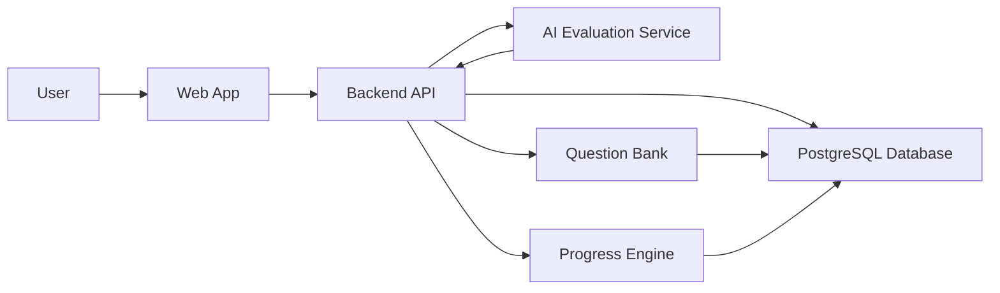
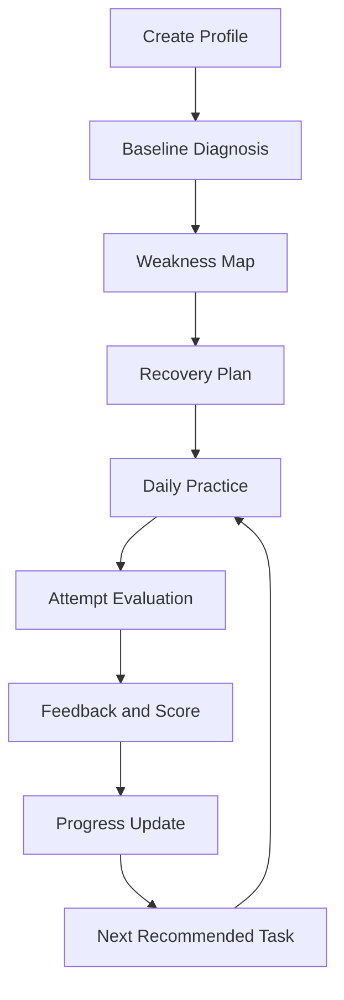
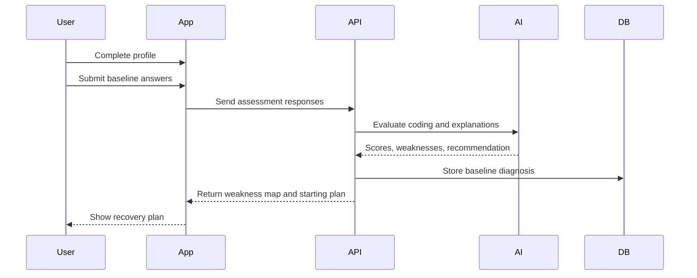
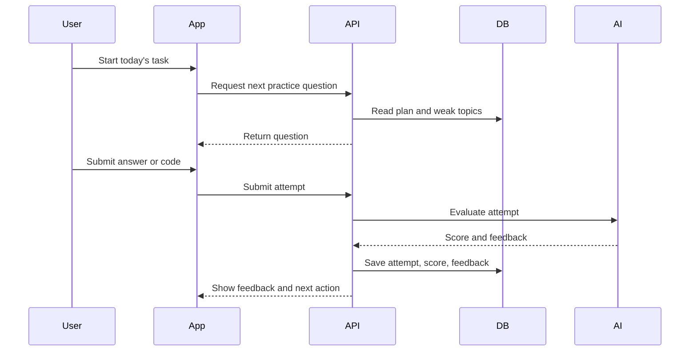
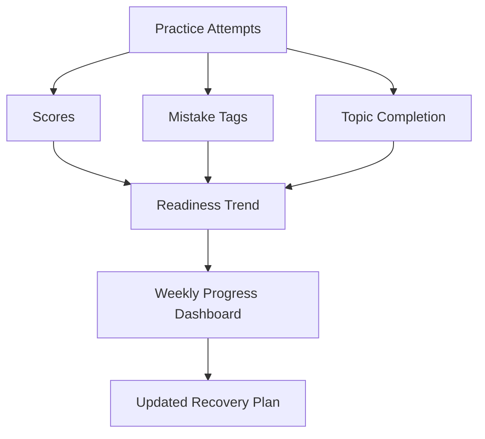

# Interview Preparation Coach Technical Design

## Document Purpose

This document defines the technical design and workflow architecture for the personal-first MVP:

`AI interview recovery coach for experienced engineers`

The first version should help one user prepare better, track progress, improve coding fundamentals, and become more interview-ready.

## Design Goals

- Keep the system simple enough to build quickly.
- Support daily practice, baseline diagnosis, progress tracking, and AI feedback.
- Store enough data to show improvement over time.
- Avoid job portal complexity in v1.
- Make the architecture easy to extend later for paid users, CV/JD fit, voice interviews, and multi-user support.

## Recommended Tech Stack

### Frontend

- `Next.js`
- `TypeScript`
- `Tailwind CSS` or a lightweight component system
- Monaco Editor later for coding practice

Why this fits:

- good structure for a multi-page product flow
- built-in routing for dashboard, practice, progress, and settings pages
- easier long-term evolution into a shipped product
- works well with a separate Go backend API
- keeps room for auth, protected routes, and future server-side needs

Why not `React + Vite` for this MVP:

- Vite is excellent for lightweight frontend-only apps
- this product already has enough workflow depth that a more opinionated app structure will help
- using Next.js now avoids a likely migration later if the product grows

### Backend

- `Go`
- `Chi` for routing
- `pgx` for PostgreSQL access
- `sqlc` for typed query generation
- `golang-migrate` for schema migrations
- REST APIs for v1
- Background jobs later for reports and reminders

Why this fits:

- strong performance with simple deployment
- clean API boundaries
- good fit for PostgreSQL-heavy applications
- easy to keep AI orchestration on the server side

### Database

- `PostgreSQL`
- Use relational tables for users, sessions, attempts, scores, plans, and progress.

### AI Layer

- LLM API for:
  - baseline diagnosis
  - question generation
  - answer evaluation
  - feedback summaries
  - recovery plan generation

### Storage

- Local storage or object storage later for:
  - uploaded resumes
  - generated reports
  - exported progress snapshots

For v1, resume upload can be deferred.

## High-Level Architecture



## Backend Structure Recommendation

Suggested Go service layout:

- `cmd/api` for application entrypoint
- `internal/http` for routes and handlers
- `internal/service` for business logic
- `internal/repository` for database access
- `internal/ai` for LLM integration
- `internal/progress` for scoring and readiness calculation
- `db/migrations` for schema migrations
- `db/query` for `sqlc` generated queries

This keeps the system easy to evolve without overengineering the first version.

## Main System Modules

### 1. Profile Module

Purpose:

- capture experience, current role, target role, weak areas, and interview timeline

Responsibilities:

- create preparation profile
- update target goals
- store current recovery focus

Core data:

- years of experience
- current role
- target role
- target companies
- weak areas
- interview date or timeline

### 2. Baseline Diagnosis Module

Purpose:

- identify current weak areas using evidence

Responsibilities:

- run basic programming assessment
- run starter DSA assessment
- collect technical explanation response
- collect confidence self-rating
- generate initial diagnosis summary

Output:

- baseline score
- weakness map
- recommended recovery level

### 3. Recovery Plan Module

Purpose:

- convert diagnosis into a daily or weekly preparation plan

Responsibilities:

- generate plan
- update plan based on progress
- recommend next practice item

Output:

- today task
- weekly goals
- weak topics
- deferred topics

### 4. Practice Module

Purpose:

- provide structured basic programming and DSA recovery practice

Responsibilities:

- show practice problems
- record attempts
- capture time taken
- capture answer and code
- mark topic and difficulty

Problem categories:

- basic programming
- arrays
- strings
- hash maps
- two pointers
- sliding window
- recursion basics

### 5. Mock Interview Module

Purpose:

- simulate interview-style practice

Responsibilities:

- ask one question at a time
- generate follow-up questions
- evaluate answer quality
- score performance using rubric

Rubric:

- correctness
- approach
- edge cases
- code clarity
- communication clarity
- confidence
- time taken

### 6. Progress Tracking Module

Purpose:

- show whether preparation is improving

Responsibilities:

- calculate streaks
- calculate topic completion
- track scores over time
- show repeated mistakes
- show readiness trend

Core metrics:

- practice days in last 30 days
- problems solved
- coding correctness
- repeated mistake count
- mock interview score
- confidence self-rating

### 7. AI Feedback Module

Purpose:

- give useful, practical feedback after each attempt

Responsibilities:

- evaluate answer/code
- identify missing edge cases
- suggest better explanation
- recommend next topic
- summarize improvement

## Personal-First MVP Workflow



## Baseline Diagnosis Workflow



## Daily Practice Workflow



## Progress Tracking Workflow



## Suggested Data Model

### users

Stores the user account.

Fields:

- `id`
- `name`
- `email`
- `created_at`

### preparation_profiles

Stores interview preparation profile.

Fields:

- `id`
- `user_id`
- `years_experience`
- `current_role`
- `target_role`
- `target_companies`
- `interview_timeline`
- `primary_weak_areas`

### baseline_assessments

Stores first diagnosis result.

Fields:

- `id`
- `user_id`
- `basic_programming_score`
- `dsa_score`
- `communication_score`
- `confidence_score`
- `weakness_summary`
- `recommended_start_level`
- `created_at`

### recovery_plans

Stores generated plan.

Fields:

- `id`
- `user_id`
- `start_date`
- `current_week`
- `focus_topics`
- `today_task`
- `plan_status`

### questions

Stores practice and mock questions.

Fields:

- `id`
- `type`
- `topic`
- `level`
- `prompt`
- `expected_concepts`
- `sample_solution`

### practice_attempts

Stores user attempts.

Fields:

- `id`
- `user_id`
- `question_id`
- `answer_text`
- `code_text`
- `time_taken_seconds`
- `submitted_at`

### evaluations

Stores scores and feedback.

Fields:

- `id`
- `attempt_id`
- `correctness_score`
- `approach_score`
- `edge_case_score`
- `code_clarity_score`
- `communication_score`
- `confidence_score`
- `feedback_summary`
- `next_recommendation`

### progress_snapshots

Stores weekly or daily progress.

Fields:

- `id`
- `user_id`
- `period_start`
- `period_end`
- `practice_days`
- `problems_solved`
- `mock_sessions`
- `average_score`
- `repeated_mistakes`
- `readiness_score`

## API Design

The frontend should call a standalone Go REST API.

Suggested API characteristics:

- JSON request and response bodies
- stateless auth for later multi-user support
- handler -> service -> repository structure
- AI calls only from service layer
- database queries generated or strongly typed through `sqlc`

### Profile APIs

- `POST /api/profile`
- `GET /api/profile`
- `PATCH /api/profile`

### Diagnosis APIs

- `POST /api/diagnosis/start`
- `POST /api/diagnosis/submit`
- `GET /api/diagnosis/latest`

### Plan APIs

- `POST /api/plan/generate`
- `GET /api/plan/today`
- `PATCH /api/plan/update`

### Practice APIs

- `GET /api/practice/next`
- `POST /api/practice/attempt`
- `GET /api/practice/history`

### Mock Interview APIs

- `POST /api/mock/start`
- `POST /api/mock/answer`
- `POST /api/mock/end`

### Progress APIs

- `GET /api/progress/summary`
- `GET /api/progress/topics`
- `GET /api/progress/readiness`

## AI Evaluation Design

The AI layer should be wrapped behind backend service functions so the frontend never calls the LLM directly.

Suggested internal functions:

- `evaluateBaselineAssessment`
- `generateRecoveryPlan`
- `evaluatePracticeAttempt`
- `generateFollowUpQuestion`
- `summarizeWeeklyProgress`

The backend should store:

- prompt version
- raw score output
- normalized score
- final feedback shown to user

This helps debug bad feedback later.

## Go Implementation Notes

Recommended libraries and tools:

- `go-chi/chi` for routing
- `jackc/pgx` for PostgreSQL driver and pooling
- `sqlc` for typed SQL queries
- `golang-migrate` for migrations
- structured logging with `slog` or `zap`
- configuration via environment variables

Suggested backend request flow:

`HTTP Handler -> Service -> AI / Repository -> PostgreSQL`

This keeps:

- HTTP logic thin
- business logic testable
- database access explicit
- AI integration isolated behind service interfaces

## Readiness Score Formula

The first version can use a simple weighted score.

```text
Readiness Score =
  30% coding correctness
  20% DSA progress
  20% mock interview score
  15% consistency
  15% confidence trend
```

The score should be presented as guidance, not as a hiring prediction.

## First Usable Release

The first usable release should include only:

- profile setup
- baseline diagnosis
- recovery plan
- daily practice log
- basic programming practice
- progress dashboard

Mock interviews can be added immediately after this foundation is working.

## Future Extensions

After the personal recovery loop works, the system can expand to:

- CV / JD fit analysis
- React machine coding practice
- voice mock interviews
- payment and subscriptions
- multi-user beta access
- cohort tracking
- admin content management

## Security and Privacy Notes

- Store resumes only when CV/JD analysis is introduced.
- Do not send unnecessary personal data to the AI provider.
- Keep API keys only on the backend.
- Store user answers and scores securely.
- Add delete-account and delete-data support before public beta.

## Final Recommendation

Build the system around the recovery loop:

`diagnose -> plan -> practice -> evaluate -> track -> adjust`

This loop is the heart of the product. If this loop helps the first user prepare better and feel real progress, the product has a strong foundation for later startup-level expansion.

Recommended v1 stack:

`Next.js frontend + Go Chi backend + PostgreSQL + pgx/sqlc + AI service wrapper`
