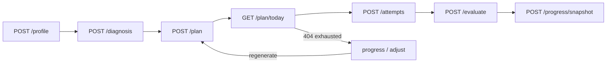

# Phase 10 — End-to-end loop review

**Date:** 2026-06-30  
**Scope:** profile → diagnosis → plan → practice → evaluate → progress → adjust  
**Automated checks:** `go test ./...` pass · `npm run build` pass

---

## Summary

Phases 9 and 10 are complete in code. The recovery loop is wired front-to-back: diagnosis auto-generates a plan, practice deep-links to today's task, evaluation refreshes progress snapshots, and the dashboard routes users through `practice` → `progress` → `adjust` when tasks are exhausted.

A structured review found and fixed reliability issues in backend status codes, snapshot upsert behavior, workflow stage routing, and React Query cache invalidation. **Manual QA against a live DB + OpenAI is still pending** before deployment.

---

## Issues found and fixes applied

### Backend

| Issue | Fix |
|-------|-----|
| `POST /progress/snapshot` always returned 201 on refresh | Service returns `(response, created)`; handler uses **201** create / **200** refresh |
| Dead 409 mapping for duplicate snapshots | Removed unused `ErrProgressSnapshotAlreadyExists` / `ErrProgressSnapshotNotOwned` |
| Concurrent snapshot creates could hit unique constraint → 500 | On Postgres `23505`, fall back to `Update` |
| `GET /diagnosis` with no profile returned misleading 404 | Returns **412** via `ErrProfileMissing` |
| Profile invalid JSON used non-JSON `http.Error` body | Returns JSON `{"error":"invalid request body"}` |
| Unsupported question type on evaluate → 500 | Pre-validate type; return **400** validation error |
| Concurrent evaluate race on unique `attempt_id` → 500 | Map unique violation to `ErrEvaluationAlreadyExists` → **409** |
| `planTaskCounts` silently swallowed DB errors | Log warnings on unexpected failures |
| No test for plan exhaustion | Added `TestPlanGetTodayExhausted` |

### Frontend

| Issue | Fix |
|-------|-----|
| `adjust` stage blocked active practice when old snapshot had recommendation | Only enter `adjust`/`progress` when `GET /plan/today` is 404 |
| Workflow stage flashed `practice` then jumped | Include `progress.isLoading` in `isLoading` |
| Snapshot history stale after evaluation | Invalidate `["progress", "snapshots"]` prefix |
| Attempts list stale after submit | Invalidate `["attempts"]` prefix |
| Diagnosis saved but plan generation failed left stale cache | `setQueryData` for diagnosis on plan failure; clearer error |
| `completeTask` 409 left UI stale | `onError` invalidates plan/today on conflict |
| Evaluate 409 showed error with no feedback | Fetch and display existing evaluation |
| Progress page hid 500/502 on latest snapshot | Show `ErrorAlert` for non-404 errors |
| Plan regenerate didn't refresh progress stats | Invalidate `progressLatest` after `useGeneratePlan` |

### Verified working (no change)

- Precondition chain: profile → diagnosis → plan (**412** when missing)
- AI failures on diagnosis/plan/evaluate → **502**; progress degrades (`status: degraded_ai_summary`)
- Plan exhaustion: all tasks done → `GET /plan/today` **404** (`ErrNoTasksRemaining`)
- Task already complete → **PATCH** **409**
- Evaluation idempotency → **409** on re-evaluate
- Post-evaluate snapshot refresh (backend upsert + frontend `createSnapshot()`)
- Recommended question matching (`task.category` ↔ `question.type`)
- Diagnostic report parsing (JSON + base64 JSONB)

---

## Manual test checklist

Run with API on `:8080`, frontend on `:3000`, Postgres seeded.

| Step | Action | Expected | Status |
|------|--------|----------|--------|
| Profile | Submit onboarding form | `POST /profile` → 201; dashboard advances | ⬜ |
| Profile missing | `GET /diagnosis` before profile | **412** precondition failed | ⬜ |
| Diagnosis | Submit all three answers | Diagnosis + plan saved; redirect to `/` | ⬜ |
| Diagnosis partial fail | Plan AI down after diagnosis succeeds | Diagnosis visible; error names plan step | ⬜ |
| Plan today | Load dashboard | Today's task + recommended question link | ⬜ |
| Practice | Submit answer on recommended question | Attempt saved; evaluation runs | ⬜ |
| Evaluate retry | Re-evaluate same attempt | **409**; existing feedback shown | ⬜ |
| Task complete | After evaluation | Task marked complete; next task on refresh | ⬜ |
| Progress refresh | Complete practice | Latest progress + history update | ⬜ |
| Snapshot upsert | Evaluate twice same day | Second snapshot POST → **200** | ⬜ |
| Plan exhausted | Complete all tasks | `GET /plan/today` 404; stage → progress/adjust | ⬜ |
| Adjust with active task | Old snapshot has recommendation but tasks remain | Stage stays `practice` | ⬜ |
| AI degraded | Break OpenAI key; create snapshot | Stats saved; degraded banner shown | ⬜ |
| Regenerate plan | From `/plan` after exhaustion | New tasks; progress stats refresh | ⬜ |

---

## Remaining gaps before deployment

| Gap | Severity | Notes |
|-----|----------|-------|
| Manual QA not run | **High** | Automated tests pass; live DB + OpenAI walkthrough still needed |
| No integration tests against real Postgres | Medium | Unique-constraint/race paths untested end-to-end |
| Diagnosis resubmit creates orphan rows | Low | `GET` returns latest; always 201 — acceptable for MVP |
| Plan status never flips to `completed` | Low | Exhaustion inferred from `GET /plan/today` 404 only |
| Tasks completable out of order | Low | `GetToday` returns lowest incomplete sequence |
| Diagnosis/plan/evaluate have no degraded fallback | Low | Only progress degrades; hard 502 elsewhere is intentional |
| Mock interview backend stubbed | Out of scope | UI shell only |
| 412 not surfaced with guided UI on all pages | Low | `isPreconditionFailed` exists; generic errors on some pages |
| No deploy artifacts | **Blocker** | Docker/compose/EC2 not started (Phase 11) |

---

## Loop flow

**Adjust** = user reads `adjustment_recommendation` on the progress page and manually regenerates via `POST /plan`.

---

## Recommended follow-ups

1. Run the manual test checklist above with live DB and OpenAI key.
2. Commit Phase 10 review fixes (backend + frontend reliability patches).
3. Optional: map `isPreconditionFailed` on diagnosis/plan/progress to guided next-step links.
4. Optional: one Postgres integration test for snapshot upsert + plan exhaustion.
5. Proceed to **Phase 11 — deployment** (Docker compose, env docs, smoke test).

---

## Related docs

- [STATUS.md](./STATUS.md) — phase checklist and module status
- [NEXT.md](./NEXT.md) — next implementation prompt (Phase 11)
